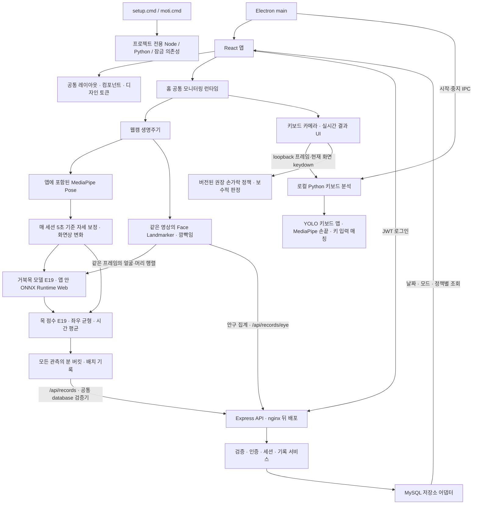

# 현재 구조와 코드 시작점

초기 소스 감사 이후 사용자 결정에 따라 구조를 정리한 현재 안내입니다. 초기 상태는 [최초 감사 기록](architecture-initial-audit.md)에 남겼습니다. 제품 방향과 미정 사항은 [product-decisions.md](product-decisions.md)를 먼저 확인합니다.

## 실행 경계

Electron 개발 앱의 키보드 모드는 로컬 Python 프로세스를 자동 실행하고 현재 화면의 카메라 프레임·키 입력을 연결합니다. 로그인과 목·좌우 균형·키보드·안구 기록은 서버 API(`/api/auth`, `/api/records`)를 사용합니다. 기존 `/api/sessions` 측정 경로는 여전히 프론트가 호출하지 않습니다. 서버 주소는 `front/.env`의 `VITE_MOTI_API_URL`이며 저장 계약은 [database](../database/README.md)를 따릅니다.

## 파일별 책임

| 경로 | 책임 / 다음 변경 시작점 |
| --- | --- |
| `toolchain.json`, `scripts/setup.ps1`, `scripts/toolchain.ps1` | 정확한 도구 버전, 검증된 다운로드, 프로젝트 전용 환경 설치 |
| `scripts/moti.ps1` | 앱/API/Python 실행과 검사 명령 묶음 |
| `scripts/package-windows.ps1` | 새 임시 폴더에서 로컬 Electron 배포본으로 설치 파일 생성 후 `front/release/`에 완성 파일만 복사. 빌드 단계·완료 경로 표시 |
| `scripts/package-keyboard.ps1`, `keyboard-detect/packaging/` | Windows x64 Python 분석기·모델·네이티브 라이브러리 묶음 생성. 실행 검사를 통과한 전체 폴더를 Electron `extraResources`의 `keyboard/`에 동봉 |
| `front/electron/main.ts` | 준비된 주 창 표시, Python 키보드 프로세스, 신뢰 창 IPC·종료 전 기록 flush 요청. 화면이 여는 새 창(window.open)은 카메라 설정 창만 허용하고, 카카오맵 장소 링크(`externalLinks.ts`)는 기본 브라우저로 엶 |
| `front/electron/preload.ts` | 키보드 시작·중지, motiRecords 종료 flush 및 주 창 전용 테마 IPC 경계 |
| `front/electron/diagnostics.ts`, `front/src/features/diagnostics/` | 진단 기록(2026-11-24). `%APPDATA%\Moti\logs\moti-YYYY-MM-DD.log`에 JSON 한 줄씩: 시작 정보, GPU 상태(GPU 정보를 다 받은 뒤. 시작 직후 값은 준비 전이라 쓰지 않음), 화면·GPU 프로세스 종료, 창 응답 없음, 화면 장치 변화, 절전·잠금, 종료 때 저장 응답/5초 초과, 1분마다 프로세스 메모리·CPU와 본창이 보낸 JS 메모리·두 측정 상태, 처리되지 않은 화면 오류(분당 20개). 2026-11-25부터 키보드 분석기 시작·종료(예상 밖 종료면 종료 코드·신호·실행 초와 요청 줄을 뺀 마지막 출력 1,500자)와 키보드 화면의 "로컬 분석 연결이 끊어졌습니다"·"영상 분석 응답이 지연…" 순간(끊긴 이유, 단계, 응답받은 프레임 수, 가장 느린 응답 ms)도 적음. 영상·랜드마크·점수는 적지 않고 14일 지난 파일은 지움 |
| `front/electron/overlayWindow.ts`, `front/overlay.html`, `front/src/features/overlay/` | 작은 창(430×144 / 430×232 DIP)·준비 확인·위치 보정·복귀, 검증된 요약/명령 계약. `snapshot.ts`가 점수 고리와 깜빡임 빈도에 표시할 값를 만듦. 중지 팝업의 통계 버튼은 본창을 복원해 모드별 통계를 엶. 측정은 본창 Provider가 계속 소유하며 작은 창은 별도 메모리 partition에서 제한된 API만 사용 |
| `front/electron/notificationHandlers.ts`, `front/src/features/notifications/` | main의 포커스/오버레이/잠금 검사, 고정 문구 Windows 알림, 목·좌우 균형 점수와 키보드 최근 50회 평균이 모드별 "N점 이하 N초 유지"인지(설정)·기존 깜빡임 15초 신호와 전달 ACK, 운영 오류별 사건 큐(키보드 자동 인식 실패 `keyboard-area` 포함). 키보드 입력은 이벤트마다 처리하고 경고별 반복 제한을 독립 관리. 점수·기록 정책과 분리 |
| `front/vite.config.ts` | UI와 Electron 빌드, CommonJS preload 출력, 브라우저 검증 모드 |
| `front/src/App.tsx` | 라우트 정의와 네이티브 제목 표시줄 테마 동기화. 인증 보호 라우트는 아직 없음 |
| `front/src/components/layout/WindowTitleBar.tsx`, `front/electron/windowAppearance.ts` | 테마 제목 표시줄과 Windows 기본 창 버튼 overlay. 브라우저에는 자체 표시줄을 추가하지 않음 |
| `front/src/components/layout/AppLayout.tsx` | 사이드바와 공통 화면 틀/Outlet |
| `front/src/styles/tokens.css` | 공통 색상, 의미별 CSS 변수, 다크 테마, 대시보드 모드 색(`mode-*`)·`track`·`nav-active`, 스크롤바 색(`scrollbar*`). 스크롤바 모양(둥근 회색 막대·위아래 작은 삼각형 버튼, 두 테마 공통)은 `index.css`의 `::-webkit-scrollbar` 규칙이며, 요소에 `scrollbar-color`/`scrollbar-width`를 주면 Chromium이 이 규칙을 끄므로 쓰지 않음 |
| `front/src/components/Button.tsx`, `Sidebar.tsx` | 공유 UI. 새 화면은 공통 토큰과 컴포넌트부터 사용. `Sidebar`는 넓은 화면에서 아이콘 아래 이름을 둔 76px 세로 줄, 좁은 화면에서 아래 막대(2026-11-24) |
| `front/src/pages/Dashboard.tsx`, `front/src/features/dashboard/` | 학습(홈) 화면. 2026-11-24부터 시안 27: 상체·키보드 두 열(`ModeCards.tsx`)이 각각 머리(이름·상태·측정 제어·카메라 설정) → 지금 점수 → 카메라 화면 → 최근 5분 점수 추이(`session/LiveScoreChart`) 순서이고, 기본 창 1100×800에 스크롤 없이 들어감. 2026-11-21부터 기록을 불러오지 않음(7일 그래프는 통계 날짜별 점수와 겹쳐 지우고, 오늘 타임라인은 학습이력과 겹쳐 지우고, 이탈 시간대는 통계 상체 탭으로 옮김). [최초 설계](superpowers/specs/2026-10-06-dashboard-redesign-design.md). `summary.ts`는 통계·학습이력이 쓰는 순수 함수(날짜 helper·정책 묶음·날짜별 값·기록 줄·이탈 시간대), `useDashboardData.ts`는 로그인 안내 문구와 조회 상태 helper만 둠. 통계·학습이력은 `format.ts`, `DayDetail`, `ScoreRing`, `SourceState`도 가져다 씀 |
| `front/src/components/AppDialog.tsx`, `components/dialog/ModalFrame.tsx` | 라우터 내부의 대화상자 FIFO 큐와 네이티브 모달 표시. 화면 이동/Provider 해제 때 대기 요청을 취소하고 이전 화면의 늦은 호출을 무시 |
| `front/src/components/dialog/dialogContext.ts`, `useDialog.ts` | 대화상자 타입/상태 계약과 호출 훅 |
| `features/session/MonitoringProvider.tsx` | 공통 모니터링 런타임. AppLayout에 유지해 홈 시작·화면 이동·독립 일시정지·다른 카메라 동시 실행을 연결하고, 카메라 설정 창의 모드·카메라 선택과 기준/위치 다시 잡기를 제공. 모드별 상세 화면(`/learn/:modeId`)은 2026-11-21에 없앴고 예전 주소는 홈으로 연결. [흐름](monitoring.md) |
| `front/src/features/session/` | 두 모드의 지속 런타임·시작/일시정지/재개/중지·활성 시간·캔버스 복사 미리보기·실시간 그래프·공통 상세 틀. 장치 선택은 카메라 설정 창에 저장 |
| `front/src/features/session/analysisFrame.ts` | 네이티브 앱의 카메라 변환·자세/안구 분석 예약. Windows 최소화에서 RAF가 느려져도 취소 가능한 30ms 타이머로 새 영상만 처리하며, 브라우저는 기존 RAF 사용. 캡처 시각·중복 프레임·단일 추론·자원 해제 계약 유지 |
| `front/src/features/camera/`, `front/electron/cameraWindow.ts` | 모드·실제 카메라별 구도 자동 저장, 확대·이동까지 공통 변환 영상으로 분석, 동일 스트림의 별도 설정 창, 수동 키보드 외곽/방향 UI. [계약](camera-settings.md) |
| `front/src/features/posture/PostureMetrics.tsx` | 목 점수(아래에 추정 CVA)·좌우 균형 점수 다이얼(`features/session/ScoreDial.tsx`)과 깜빡임 빈도 반원 계기(`RateGauge.tsx`, 끝값 30은 그림 눈금일 뿐 기준이 아님)의 지금 값(세션 평균은 종료 팝업과 통계). 추정 CVA = 기준 50° − 같은 목 점수에서 환산한 CVA 감소량(`modes/turtle.ts`). 점수 산식·임계값을 소유하지 않음. 키보드 열은 같은 다이얼과 `MetricTile`(판정 가능 비율·판정한 입력). 키보드 다이얼은 2026-11-25부터 최근 50회 판정 평균의 정수(`features/keyboard/liveScore.ts`) |
| `front/src/features/posture/e19/` | 거북목 모델 E19(`public/models/fhp-e19`) 실행. `model.ts` 보정·추론(연구 런타임의 E19 부분), `flow.ts` 3초 준비·5초 기록·실패 안내 후 재시도와 One Euro, `frame.ts` 같은 영상 프레임의 포즈·얼굴 짝짓기, `load.ts` 앱 안의 모델·ORT wasm 로딩(CDN 없음), `cva_map.json` 목 부하 → CVA 감소 환산표(인계 패키지 그대로). [보정 계약](calibration.md#거북목-모델-e19-보정-2026-11-23) |
| `front/src/features/posture/CameraGuidance.tsx`, `guidance.ts`, `features/session/GuidanceBand.tsx`, `KeyboardGuidance.tsx` | 카메라 화면 아래쪽 안내 띠(상체: 보정·깜빡임 보정·관찰 불가·오류, 키보드: 준비·위치 인식·오류·미승인 앱). 2026-11-23부터 별도 회색 안내 칸 없음 |
| `front/src/features/posture/monitorTypes.ts` | 카메라와 독립된 상태·점수·습관 표시 계약 |
| `front/src/components/PostureMonitor.tsx` | 웹캠·모델·기준 수집 연결(5초 보정에서 자세 기준·E19 보정·좌우 균형 기준을 함께), E19 추론(초당 약 10회)과 목·좌우 균형 점수 평가(각자 One Euro·관찰 시간), 오버레이, 누락/오류 상태 전달 |
| `front/src/components/KeyboardMonitor.tsx` | 동일 변환의 손캠 미리보기/프레임 전송, 현재 화면·승인 앱 입력 연결, 키 맵 재인식, 종료/실패 정리. 자동 인식 상태(`recognition`: 찾는 중·찾음·직접 맞추기 대기·직접 맞춘 영역)를 내보내고, 10초 동안 못 찾으면 직접 맞추기로 바꾼 뒤 영역을 맞출 때까지 판정하지 않음(대기 표시는 카메라 런타임의 `manualPending`). 판정한 입력마다 최근 50회 점수(`scores`)를 갱신 |
| `front/src/features/keyboard/` | Python 인식 결과 어댑터, 버전된 권장 손가락표, 신뢰도·모호성 기반 순수 판정 |
| `front/src/hooks/useWebcam.ts` | 장치 요청과 트랙 해제. 늦게 완료된 이전 요청도 폐기 |
| `front/src/hooks/useMediaPipe.ts` | 로컬 Pose 파일 로드, 프레임 처리, 비동기 초기화/종료 제어 |
| `front/src/features/posture/calibration.ts` | DOM 없는 기준 자세 수집/관측 계산. 단위·품질·샘플 정책 |
| `front/src/features/posture/observation.ts` | DOM 없는 기준 대비 변화·유효 관찰 시간 계산. 누락·중복·역행 시각과 관측 연속성 처리 |
| `front/src/features/posture/modes/turtle.ts`, `modes/balance.ts` | 목: E19 목 점수 정책(100 − 목 부하 점수, 습관 편차·추정 CVA 환산(부하 기준, `e19/cva_map.json` 선형 보간), 정책 ID `upper-body-neck-e19-v1-<해시>`). 좌우 균형(2026-11-25, 어깨 점수를 대신함): 고개 기울기(머리 행렬 roll)와 양 어깨가 또렷하면 어깨선 기울기 중 보정 때보다 더 기운 각도를 3°/18° → 100/0점으로 환산(설정의 좌우 균형 민감도 10–100%가 두 각도를 바꿈, `balancePolicy`), 정책 ID `upper-body-balance-v1-<해시>`(50%가 아니면 `:s<값>`) |
| `front/src/features/posture/evaluation.ts` | 측정한 점수를 정수로 만들어 유효 시간 가중 평균·연속 관찰·기준 이탈 구간을 집계하는 순수 함수 |
| `front/src/utils/apiClient.ts`, `authStore.ts` | API 주소·JWT 세션 보관·401 처리, 서버 회원가입/로그인/계정 변경(가입·이메일 변경 전 이메일 인증 코드), 이메일로 아이디 찾기·비밀번호 재설정(`pages/FindId.tsx`, `FindPassword.tsx`) |
| `database/contracts.ts`, `keyboard.ts`, `eye.ts`, `eyeRecorder.ts`, `recorder.ts`, `aggregation.ts` | 자세·키보드 직렬화 계약·순수 집계. 프론트와 서버가 같은 검증기를 사용 |
| `front/src/features/records/` | 저장 배치/실패 재시도·HTTP 기록 API·조회 상태·목/좌우 균형 표시 어댑터. 측정의 마지막 배치가 저장되면 `refresh.ts`가 신호를 보내고 `useRecordQuery`가 열린 화면(홈·통계·학습이력)을 이전 값을 유지한 채 다시 불러옴. AI/의학 예시는 별도 컴포넌트 |
| `front/src/pages/Statistics.tsx`, `front/src/features/statistics/` | 통계(1/7/30일, 기본 1일, 직전 같은 길이 기간 비교, 상체·키보드·안구 탭). `period.ts`가 세 출처 응답으로 기간 값(상체의 시간대별 점수·기준 이탈이 잦은 시간 포함)을 계산하는 순수 함수(상체는 점수 정책으로만 묶어 기준 이탈 규칙이 다른 기록도 함께 셈, `dashboard/summary.ts`의 `latestPolicyGroups`), `useStatisticsData.ts`가 불러옴. 키보드 탭은 `features/keyboard/KeyboardStatistics.tsx`(계산은 키보드 담당). [설계](superpowers/specs/2026-10-06-stats-history-redesign-design.md) |
| `front/src/pages/LearningHistory.tsx`, `front/src/features/history/` | 학습이력(주간·월간 달력, 시작일별 기록 줄(2026-11-25부터 최신순), 오른쪽 상세, 기록 없는 날). `calendar.ts`가 달력·기록 줄·앞뒤 기록을 계산하고 `currentPolicies.ts`가 "이전 기준"을 판단. 2026-11-25부터 마지막 저장이 3분 넘게 지난 `running` 기록(앱이 마지막 저장 없이 꺼짐)은 "중단됨"으로 봄(`dashboard/summary.ts`의 `STALE_RUNNING_MS`). 오른쪽 상세(`RecordDetail.tsx`)는 세 모드가 같은 틀: 머리줄(모드·시각·상태) → 상자 없는 숫자 3–4개(`detail.ts`의 `detailStats`, 기록 줄 자료만 씀) → 그림 하나(상체 분별 목·좌우 균형 점수, 안구 분별 깜빡임 빈도, 키보드는 `KeyboardRecordDetail`의 키 히트맵·선택 키) |
| `front/src/pages/Settings.tsx`, `front/src/features/settings/` | 계정, 비밀번호·이메일, 화면 테마, 알림, 데이터 관리, 키보드·승인 앱 관찰을 카드로 표시함. `parts.tsx`는 카드·입력·버튼·스위치·단계 조절을 공유함. `preferences.ts`는 상체 측정의 고정값(좌우 균형 10%, 추정 CVA 50°, 깜빡임 보통)을 제공함. 알림 카드에서 상체와 키보드 각각의 경고 점수·유지 시간과 소리를 설정함. 같은 경고는 상황별 한 번, 새 상황에 최소 5초 간격으로 표시함. [알림 규칙](monitoring.md#windows-자세-경고-알림) |
| `front/src/pages/AiReview.tsx`, `front/src/features/ai-review/` | AI 총평(`/ai-review`, 7·30일). `input.ts`가 측정 집계를 요청 형태로 바꾸고 보내기 전에 표시하며, `ReviewCards.tsx`가 한 줄 요약·총평·영역별 문단·잘한 점·아쉬운 점·다음 목표를 보여 줌. 상체는 날짜별·시간대별 값을 포함한 기기 측정 요약을 우선 사용하고, 없으면 서버 통계를 씀(`useReviewInput.ts`). [안내](ai-review.md) |
| `front/src/features/hospitals/` | 주변 병원 찾기(AI 총평 화면 맨 아래, 점수·총평과 연결하지 않음). 진료과와 동네·주소 또는 약 1km로 반올림한 현재 위치로 `GET /api/hospitals`를 부르고, `kakaoMap.ts`가 불러온 카카오 지도 SDK에 마커와 목록을 함께 표시. [안내](nearby-hospitals.md) |
| `front/src/features/keyboard/KeyboardRecordDetail.tsx`, `KeyboardKeyExploration.tsx`, `keyExploration.ts` | 학습이력 키보드 세션의 키 히트맵(카드 없이 상세 패널 위), 통계/이력 공용 히트맵·선택 키 표시, DOM 없는 키별 집계. 카메라/실시간 점수 정책을 소유하지 않음 |
| `server/src/server.ts`, `config.ts` | 환경 검증 후 서버 시작. JWT 비밀값 자동 기본값 없음. AI 총평 미니 PC 주소(`MOTI_REVIEW_GATEWAY_URL`)는 선택 |
| `server/src/app.ts`, `http.ts` | API 조립과 공통 비동기 오류 응답 |
| `server/src/validation.ts` | HTTP 입력을 런타임에서 검사 |
| `server/src/routes/` | HTTP 계약/인증/응답 변환 |
| `server/src/services/sessions.ts` | 세션 소유권, 종료 정책, 측정 입력 파서, 트랜잭션 작업 경계 |
| `server/src/services/statistics.ts` | 오늘·달력의 세션 수 가중 평균. 누락 평균과 실제 0점 구분 |
| `server/src/repositories/sessions.ts` | MySQL SQL, 행 잠금, 트랜잭션, 통계 집계, 지표·날짜별 측정 데이터 기록/조회 |
| `server/src/routes/feedback.ts` | 날짜·모드 단위 피드백 기록/조회. 서버가 요약을 만들지는 않음 |
| `server/src/routes/ai.ts`, `services/aiReview.ts` | AI 총평 `POST /api/ai/review`. 인증과 MySQL 요청 한도를 적용하고, `reviewFacts.ts`가 측정 집계로 한 줄 요약·영역별 문단·목록을 만듦. 미니 PC(`MOTI_REVIEW_GATEWAY_URL`)가 고른 습관은 총평 문단 끝에 붙음(`reviewAdvice.ts`). 게이트웨이 주소가 없으면 503을 반환하며 총평 결과는 저장하지 않음. [안내](ai-review.md) |
| `server/src/routes/hospitals.ts`, `services/hospitals.ts` | 주변 병원 찾기 `GET /api/hospitals`(토큰 사용자만). 진료과 4개만 받고, 카카오 로컬 API로 위치를 찾은 뒤 반경 5km 병원을 거리순 15곳 반환. `KAKAO_REST_API_KEY`가 없으면 503, 위치는 저장·로그하지 않음. [안내](nearby-hospitals.md) |
| `server/src/routes/records.ts`, `repositories/records.ts`, `migrations/002_record_tables.sql` | 앱 기록 API(토큰 사용자만), MySQL 트랜잭션 저장·조회·삭제 세대 |
| `server/migrations/` | 기존 DB에 적용하는 변경. `schema.sql`은 새 DB용 전체 정의 |
| `server/test/` | 입력·인증·HTTP 오류·세션 재시도/소유권 회귀 검사 |
| `keyboard-detect/pyproject.toml`, `uv.lock` | Python 의존성의 입력 선언과 정확한 해결 결과 |
| `keyboard-detect/src/` | 키보드 검출·원근 변환·키 영역 판정 |
| `keyboard-detect/keylog/` | 로컬 Socket.IO 서비스, 키 이벤트·프레임 시간 매칭, 키 맵·손끝 후보 생성 |
| `keyboard-detect/scripts/check_environment.py` | 카메라/키 수집 없이 Python import·모델·맵 확인 |

## 측정 화면의 계약

홈 실행 카드는 `상체 / 키보드` 두 개입니다. 상체는 목·좌우 균형·깜빡임을 한 카메라로 분석하며 시작은 화면 이동 없이 작동합니다. 두 카메라와 일시정지를 독립적으로 유지하고 카드의 설정 아이콘은 카메라 설정 창을 엽니다. 통계의 저장 부위 탭 `상체 / 키보드 / 안구`와 기존 기록/이력은 보존합니다. 통계는 1/7/30일과 직전 기간을 비교하고 최신 정책 묶음만 사용합니다. 실시간 점수 그래프는 홈 카드 아래에서 목·좌우 균형 또는 키보드를 표시하며 안구 점수는 만들지 않습니다. [모니터링](monitoring.md)

상체 계산은 `AppLayout → MonitoringProvider → PostureMonitor → useWebcam/useMediaPipe → 5초 보정(자세 기준 calibration + E19 + 좌우 균형 기준) → observation(안내 이유·관찰 시간 표시) → 목: E19 추론·One Euro / 좌우 균형: 고개·어깨선 각도·One Euro → evaluation → MonitorSnapshot` 순서입니다. `EyeMonitor(shared) → Face Landmarker → measurement`는 같은 변환 캔버스를 빌려 깜빡임을 계산하며 별도 카메라를 열거나 상체 트랙을 종료하지 않습니다. 같은 얼굴 결과(478점·머리 행렬)를 캡처 시각·영상 시각과 함께 `MonitoringProvider`의 얼굴 버퍼로 넘기고, `PostureMonitor`가 같은 영상 프레임의 포즈와 짝지어 E19에 넣습니다. 홈 카드의 `PostureMetrics`가 공통 상태를, 카메라 화면 아래 띠(`CameraGuidance`)가 안내를 표시합니다. 기준 다시 잡기는 스트림을 유지하며 자세 기준/기록 구간을 새로 수집하고 깜빡임 누적은 보존합니다. 일시정지는 관측 연속성을 끊고 기준·평균을 유지하며, 중지는 트랙·모델을 해제하고 종료 배치를 보냅니다. 페이지 이동은 계속 관찰합니다. 기존 안구 서버 집계와 통계·이력은 유지하며 휴식 UI는 제거했습니다.

키보드는 `MonitoringProvider → KeyboardMonitor → loopback Python service → runtime adapter → finger policy → aggregate recording` 순서이며 홈 키보드 카드가 화면입니다. Electron main은 빈 로컬 포트와 세션 토큰으로 개발 시 `.venv` Python을, 설치 앱에서는 `resources/keyboard/moti-keyboard.exe`를 실행합니다. 설치 분석기는 Python·CPU 추론 라이브러리·모델·키 맵을 함께 배포하며 사용자에게 별도 Python 설치를 요구하지 않습니다. 기본 입력은 Moti 화면의 물리 `code`이고 설정에서 승인한 일반 앱은 시작 때 함께 관찰합니다. 빈 승인 목록은 Moti 관찰만 실행합니다. 일시정지는 입력/프레임·승인 앱 관찰을 멈추고 서버의 임시 프레임/입력 큐를 비우며 재개 때 맵을 새로 확인하고 기존 세션 집계를 이어갑니다. 승인 경로·foreground 권한과 미승인·관리자·확인 불가 앱 제외 경계는 유지합니다.

안구 v3는 3초간 열린 양쪽 눈·거리 기준을 수집하고 안내된 양안 깜빡임 3회로 개인별 판정 기준을 정합니다. `blinkCalibration.ts`가 순수 기준 수집·양안 주기를, `EyeCalibrationGuide.tsx`가 홈 상체 카드에서 보정 진행을 안내합니다. 공통 모니터링 런타임이 보통 민감도로 측정하고 `eye-habits-v3:normal`로 저장합니다. 기존 v2 및 다른 민감도와 합산하지 않습니다. 개인 눈 기준은 세션 메모리에만 두며, 교정 동작은 측정 횟수·유효 시간에서 제외합니다. 기준 재수집과 짧은 프레임의 보호 조건은 안구 가이드를 따릅니다.

Python은 손끝 후보와 프레임 시간차를 반환하고 앱의 `ansi-qwerty-touch:2.0.0` 정책이 100·70·0/보류를 결정합니다. 손 가림을 직접 감지하는 모델은 없으며 관측 부족·가까운 후보·시간 차이를 보류 근거로 사용합니다. 손가락 일관성은 별도 지표이며 가산점이 아닙니다. 원문·입력 순서·영상은 저장하지 않고 날짜·키·상황·손가락·판정 횟수만 서버에 저장합니다. 정책별 통계·히트맵은 Statistics의 키보드 탭에, 세션별 키 탐색 상세는 학습이력에 있습니다. 두 화면은 히트맵/선택 키 컴포넌트를 공유합니다. 학습이력 응답에 키보드 요약이 추가되어도 학습이력 화면(모든 정책)은 키보드 줄을 키보드 통계 출처에서 한 번만 만듭니다. crop·자유 회전·필터는 미리보기와 분석에 동일하게 적용하고 변경 시 기존 맵과 프레임을 폐기합니다. 세부 산식/품질 한계는 [키보드 계약](../front/src/features/keyboard/README.md), 저장은 [database](../database/README.md)를 따릅니다.

`MonitorSnapshot`은 준비/수집/관찰/관찰 불가/오류 상태와 수집 진행률, 부위별 편차, 유효 관찰 시간, 목·좌우 균형 각각의 현재/평균 점수와 습관 집계·정책 버전, E19 보정 단계(준비·기록·계산·실패 이유·남은 초)를 전달합니다. 추정 CVA는 따로 싣지 않고 화면이 현재 목 점수에서 환산합니다. 사용자의 자세가 의학적으로 올바른지 판단하는 타입이 아닙니다.

- 2D 좌표는 이미지 가로/세로 픽셀로 환산한 뒤 어깨 너비 대비 비율을 계산합니다.
- 측정 시작·기준 다시 잡기·카메라 구도 변경 때 3초 준비 뒤 5초 동안 기준 자세를 기록합니다. 같은 5초에서 E19 보정과 자세 기준(3초 이상 연속 안정 구간의 중앙값)을 만들고, 하나라도 실패하면 이유를 3초 안내한 뒤 다시 합니다. 성공하면 같은 프레임의 고개·어깨선 각도 중앙값을 좌우 균형 기준으로 씁니다. 수집 시간은 잠정 설정이며 점수/건강 임계값이 아닙니다. [보정 계약](calibration.md)
- 얼굴·어깨가 안 보이거나 신뢰도가 낮으면 수집을 다시 시작합니다.
- 기준 확보 후 관측이 사라지거나 고개 회전 비율이 0.15를 초과하면 안내 띠에 이유를 보이고 화면의 관찰 시간 증가를 멈춥니다. 점수는 목·좌우 균형 각자의 측정 조건(아래)을 따릅니다. 이를 휴식이나 정상으로 바꾸지 않습니다.
- 관찰 시간은 단조 캡처 시각의 양수 간격 중 500ms 이하만 더합니다. 중복·역행 시각과 누락은 연속성을 끊고 같은 구간을 다시 더하지 않습니다.
- 2026-11-25부터 목·좌우 균형 현재 점수는 `evaluation.ts`가 반올림한 정수입니다. 화면·그래프·알림과 서버에 보내는 점수×시간 합계가 모두 이 정수를 씁니다. 저장 계약·DB 열은 그대로입니다.
- 목 점수는 거북목 모델 E19의 목 부하 점수(보정 자세보다 머리 무게가 앞으로 실린 정도, 150 % = 100점)를 One Euro 필터로 다듬어 100에서 뺀 값입니다. 움직임 보호·유예·복귀 확인은 적용하지 않고, E19 자체 검사(고개 좌우 25° 등)만 따르며 관찰 시간도 따로 셉니다. 목·좌우 균형 둘 다 못 잴 때만 관찰 불가입니다. [평가](evaluation.md#목-점수-e19-2026-11-23)
- 좌우 균형(2026-11-25, 어깨 점수를 대신함)은 고개 기울기(같은 프레임 얼굴 분석의 머리 행렬 roll. 고개를 좌우로 25° 넘게 돌리면 재지 않음)와, 양 어깨 가시성이 0.7 이상이면 어깨선 기울기 중 보정 때보다 더 기운 각도를 씁니다. 좌우 균형 민감도 50%(기본)에서 3° 이내 100점, 18° 이상 0점, 사이는 직선이며(민감도를 올리면 두 각도가 작아짐) 목과 같은 One Euro 필터로 다듬습니다. 고개를 못 재면 어깨만으로 매기지 않고 관찰 시간도 세지 않습니다. 기준 이탈 편차는 목과 같은 (100 − 점수)/200입니다. 3°·18°·0.7은 잠정 설정이며 진단 기준이 아닙니다. [평가](evaluation.md#좌우-균형-점수-2026-11-25)
- 관측률·연속 관찰·지속된 기준 이탈의 기존 집계/저장 계약은 유지합니다. 새 모니터링 화면은 현재 값·세션 평균·추이를 중심으로 표시합니다. 기준 이탈과 오사용·휴식·질환 판정을 구분합니다. 산식·초기 설정·검증 한계는 [evaluation.md](evaluation.md)를 따릅니다.
- 카메라 위치를 물리적으로 옮기면 다시 수집해야 합니다. 장치 ID/해상도 변경은 자동 감지하지만 모든 물리적 이동을 자동 판별하지는 못합니다.

좌표와 기준 수집 계약은 [calibration.md](calibration.md), 모드별 개발 책임과 통합 규칙은 [collaboration.md](collaboration.md)에 있습니다.

## 서버의 유지 계약과 변경

기존 `/api/auth`, `/api/sessions`, `/api/statistics`, `/health` 경로를 유지하고 `/api/feedback`을 추가했습니다. 상세 경로는 최초 감사 기록의 API 표와 현재 routes 파일을 함께 확인합니다.

- 세션 종료는 동일 DB 트랜잭션에서 행 잠금 후 한 번만 집계합니다. 이미 끝난 세션의 재요청은 통계를 더하지 않습니다.
- 종료 입력 `score`(0–100 정수), `alertCount`(0 이상 정수)는 필수입니다. 누락한 점수를 100점으로 저장하던 동작을 제거했습니다. 이 점수 필드는 기존 API 호환 계약이며 새 자세 점수 산식이 아닙니다.
- 로그 기록에서도 세션 소유자와 종료 여부를 검사합니다. 잘못된 입력은 400, 타인의 세션은 404, 종료 후 기록은 409로 처리합니다.
- 비동기 DB 오류를 공통 오류 응답으로 전달합니다. `/health`는 DB 준비 여부를 검사하지 않습니다.
- MySQL 트랜잭션/행 잠금은 실제 배포 DB의 엔진·시간대·SQL mode에서 추가 검증해야 합니다. 이번 단위 테스트의 대역 저장소가 실제 DB를 대체해 검증해 주는 것은 아닙니다.
- 일별 집계는 자정을 넘어도 기존처럼 세션 시작일에 전체 시간을 귀속합니다. 오늘·달력 점수는 세션 수 가중 평균이며 평균이 누락된 행은 점수 분모에서 제외합니다. 다일 세션의 로그는 날짜와 분으로 그룹화합니다.

통계 그래프에 남아 있는 `AVG(measured_value) AS score`는 기존 계약입니다. 이를 새 자세 점수로 쓰면 안 됩니다.

## 측정 데이터 저장 계약

기준 자세, 지표별 관측, 키 입력 판정을 저장할 자리를 만들었습니다. 스키마 변경은 `server/migrations/001_measurement_tables.sql`이며 `server/schema.sql`에도 같은 정의가 들어 있습니다. 실제 MySQL 9.6에서 신규 설치와 기존 DB 적용 두 경로, 그리고 아래 경로를 모두 실행해 확인했습니다.

- `POST /api/sessions/:id/calibration` — 세션당 한 벌. 이미 있으면 409이며 덮어쓰지 않습니다. 기준을 다시 잡는 것은 새 세션입니다. 프론트의 `startedAtMs`/`completedAtMs`는 `performance.now()` 단조 시계이므로 시각이 아니라 수집 구간 길이(`collected_ms`)로 저장합니다.
- `POST /api/sessions/:id/logs/batch` — 최대 200건. `metric`과 `measuredValue`는 함께 보내야 하고, `UNAVAILABLE`에는 측정값을 보낼 수 없습니다. 관찰이 끊긴 구간을 GOOD/WARNING/DANGER로 바꾸지 않기 위한 경계입니다.
- `POST /api/sessions/:id/keystrokes` — 최대 200건. `unknown` 판정에는 `observedFinger`와 `confidence`가 없어야 하고 나머지 판정에는 있어야 합니다. 판별 가능한 입력만 통계의 분모로 쓰기 위해 `policy_version`과 함께 저장합니다.
- 세 경로 모두 소유자가 아니면 404, 종료된 세션이면 409입니다.
- `elapsedMs`는 세션 시작 이후 경과 시간이며 클라이언트 시계 값이 아닙니다. 서버는 DB가 찍은 `started_at`에 더해 기록 시각을 만듭니다. 보내지 않으면 DB의 `NOW()`를 씁니다.
- `GET /api/sessions/:id`는 저장된 기준 자세를 `calibration`으로 함께 돌려줍니다. 없으면 `null`이며, 그 세션의 `measured_value`는 해석할 수 없다는 뜻입니다. 그래프는 지표별로 나누어 돌려줍니다.

`sessions.score`는 여전히 필수 입력입니다. 프론트의 버전된 기준 자세 유사도 기록(`/api/records`)과 이 서버 필드는 연결하지 않았습니다. 서버 연동 시 점수 정책 매핑과 NULL 허용 여부를 별도 계약·마이그레이션으로 결정합니다. `bad_posture_seconds`와 휴식 기록은 아직 저장 계약이 없습니다.

## 사용자 설정과 피드백

- `GET`/`PUT /api/auth/me/settings` — `users.settings` JSON을 통째로 읽고 씁니다. 서버는 항목 이름을 해석하지 않고 개수(50개)·값 종류·전체 크기(4KB)만 제한합니다. 화면이 설정을 늘려도 서버를 고치지 않습니다.
- `POST`/`GET /api/feedback` — (사용자, 날짜, 모드) 단위 기록입니다. 서버는 요약을 생성하지 않으며 저장된 문장은 저장한 쪽이 쓴 것입니다.
- `POST /api/auth/email-verification`, `PUT /api/auth/me/email`, `POST /api/auth/find-id`, `POST /api/auth/password-reset`(+`/verify`, `/confirm`) — 가입 이메일로 아이디 찾기·비밀번호 재설정(2026-10-24, 코드 먼저 확인은 2026-10-28). 2026-10-30부터 회원가입과 이메일 변경은 그 주소로 받은 코드가 맞아야 저장합니다(코드 소모는 `routes/recovery.ts`의 `spendEmailCode`를 `routes/auth.ts`가 호출). 경로는 `routes/recovery.ts`, 발송은 `services/mail.ts`(SMTP)이며 설정이 없으면 메일 경로가 503이라 가입·이메일 변경도 할 수 없습니다. 코드·제한 규칙은 [database 안내](../database/README.md)를 따릅니다.

결정성·누락·임계값·자정의 자동 검증 결과와 실제 DB 검증 한계는 [evaluation.md](evaluation.md)에 정리했습니다. 키보드 평가는 이번 검증에서 제외했습니다.

## 재사용과 교체 범위

React/Electron, UI 자산, Python 키보드 맵/손끝 분석은 재사용했습니다. 비동기 카메라 연결, 기준 자세 수집, 세션 종료·검증 경계는 새로 구성했습니다. 전체 재작성보다 비용이 낮다는 설계 판단이며 성능 향상을 측정한 결과는 아닙니다.

기존 Dockerfile과 두 SQL은 이전 구현 자료입니다. 현재 개발에는 저장소 루트의 실행 스크립트와 서버 마이그레이션을 사용합니다.

안구 기록은 `EyeMonitor → EyeRecorder → features/records/api.ts → /api/records/eye → MysqlRecordRepository`로 저장합니다. 통계는 `/eye-statistics`, 통합 달력은 `/history`, 안구 상세는 `/eye/:id`를 사용하며 JWT 사용자·record_owners 잠금·삭제 세대와 재시도 계약을 다른 모드와 공유합니다.
