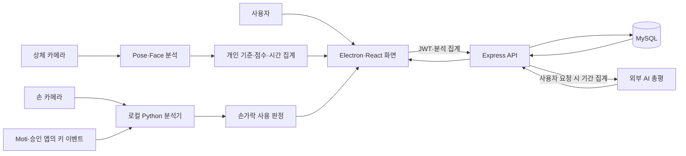

# Moti 졸업작품 최종 보고서 구성안

- 작성 기준: 2026-11-07
- 단계: 목차와 장별 집필 계획, 초록·서론의 1차 예문
- 형식: 학과 지정 양식 미확인. 본문 약 30–35쪽을 권장하며 아래 배분은 약 32쪽의 편집 계획이다. 이 파일 자체의 분량을 뜻하지 않는다.
- 구현 근거: 현재 작업 폴더의 코드와 최신 기능 문서. 확인 당시 HEAD는 `53f4ae0`이며 앱 시작 화면 관련 미커밋 변경이 함께 존재했다.
- 검증 근거: 기존 개발 가이드에 기록된 실행 결과. 이번 구성안 작성에서는 프로그램 검사, 촬영 실험, 사용자 평가를 새로 수행하지 않았다.

## 1. 보고서의 제목과 중심 이야기

### 권장 제목

**Moti: 영상 인식 기반 컴퓨터 작업 자세 및 사용 습관 모니터링 시스템**

부제는 필요할 때만 다음과 같이 붙인다.

> 개인 기준 자세와 손가락 사용 분석을 활용한 Windows 데스크톱 응용프로그램

### 보고서가 설명할 문제

컴퓨터 작업 중 자신의 자세 변화와 키보드 사용 방식을 계속 확인하기는 어렵다. Moti는 상체와 손의 영상을 관찰하고, 사용자가 현재 상태와 누적 기록을 확인할 수 있는 피드백 흐름을 제공한다.

### 보고서 전체를 잇는 순서

**사용자의 관찰 필요 → 영상 입력과 개인 기준 수집 → 모드별 분석 → 실시간 표시 → 서버 기록 → 통계와 회고**

평가자는 다음 세 가지를 파악할 수 있어야 한다.

1. 사용자가 어떤 상황에서 Moti를 사용하는가.
2. 카메라 입력이 어떤 규칙을 거쳐 화면의 수치와 기록이 되는가.
3. 구현과 검증으로 확인한 내용은 무엇이며 추가 확인이 필요한 내용은 무엇인가.

## 2. 권장 목차와 분량

표지, 초록, 목차, 참고문헌과 부록은 아래 본문 배분과 별도다. 그림 크기와 학과 양식에 따라 조정한다.

| 장 | 제목 | 권장 분량 | 핵심 질문 |
| --- | --- | ---: | --- |
| 1 | 서론 | 3쪽 | 왜 만들었고 무엇을 목표로 했는가? |
| 2 | 관련 기술 및 유사 서비스 분석 | 3쪽 | 어떤 기술과 사례를 검토했고 무엇을 선택했는가? |
| 3 | 요구사항 분석 | 3쪽 | 사용자가 수행할 작업과 시스템의 조건은 무엇인가? |
| 4 | 시스템 설계 | 4쪽 | 화면·분석기·서버·DB는 어떻게 연결되는가? |
| 5 | 핵심 분석 방법 | 7쪽 | 자세·깜빡임·키보드 결과를 어떻게 계산하는가? |
| 6 | 구현 결과 | 5쪽 | 사용 흐름이 실제 화면에서 어떻게 동작하는가? |
| 7 | 시험 및 평가 | 5쪽 | 어떤 방법으로 확인했고 결과와 한계는 무엇인가? |
| 8 | 결론 및 향후 과제 | 2쪽 | 달성한 결과와 후속 과제는 무엇인가? |
| 합계 | 본문 | 32쪽 | 설계·분석·구현·평가를 중심으로 구성 |

### 상세 목차

```text
표지
국문 초록
목차 / 그림 목차 / 표 목차

제1장 서론
  1.1 개발 배경 및 문제 정의
  1.2 개발 목적과 목표
  1.3 개발 범위와 보고서 구성

제2장 관련 기술 및 유사 서비스 분석
  2.1 영상 기반 신체·얼굴·손 랜드마크 인식
  2.2 자세 관찰 및 타이핑 학습 서비스 검토
  2.3 기존 사례와 Moti의 설계 방향 비교

제3장 요구사항 분석
  3.1 대상 사용자와 사용 시나리오
  3.2 기능 요구사항
  3.3 품질·실행 환경·데이터 처리 요구사항

제4장 시스템 설계
  4.1 전체 시스템 구성
  4.2 모니터링 상태와 카메라 생명주기
  4.3 분석 결과 전달 및 기록 저장 구조
  4.4 데이터 모델과 통계 집계
  4.5 계정 인증과 외부 AI 연동 경계

제5장 핵심 분석 방법
  5.1 영상 전처리와 입력 좌표의 일치
  5.2 세션별 기준 자세 수집
  5.3 목·어깨 기준 대비 변화와 점수 계산
  5.4 유효 관찰 시간과 시간 가중 평균
  5.5 개인 눈 기준과 깜빡임 집계
  5.6 키보드 영역·손끝·키 입력 매칭
  5.7 손가락 사용 판정과 키별 통계

제6장 구현 결과
  6.1 개발 환경과 주요 기술
  6.2 대시보드와 모니터링 실행
  6.3 상체 모니터링과 카메라 설정
  6.4 키보드 모니터링과 판정 결과
  6.5 통계·학습이력과 세션 상세
  6.6 계정·설정·AI 총평

제7장 시험 및 평가
  7.1 평가 항목과 시험 환경
  7.2 자동 검사와 기능 통합 시험
  7.3 실제 촬영 기반 분석 평가
  7.4 동시 실행 성능과 사용자 평가
  7.5 결과 해석 및 한계

제8장 결론 및 향후 과제
  8.1 구현 성과
  8.2 개발 과정의 주요 해결 과제
  8.3 향후 개선 방향

참고문헌
부록 A. 사용자 실행·설치 안내
부록 B. 상세 시험 사례와 결과
부록 C. 정책·지표 정의와 데이터 사전
부록 D. 팀 역할과 개발 일정
```

## 3. 장별 작성 내용

### 제1장 서론

**핵심:** 사용자의 관찰 필요와 Moti의 개발 목표를 연결한다.

- 대상은 컴퓨터로 학습하거나 작업하는 사용자다. 특정 질환 보유자나 환자를 대상으로 효과를 입증한 시스템으로 서술하지 않는다.
- 자세 변화, 깜빡임과 손가락 사용 양상을 현재 화면과 누적 기록에서 확인하는 필요성을 설명한다.
- 목표는 상체·키보드 관찰, 개인 기준 수집, 실시간 표시, 기록·통계 제공으로 정리한다.
- 실행 모드는 상체와 키보드 두 개다. 목·어깨·깜빡임은 상체에 통합되어 있다.
- AI 총평은 기록을 설명하는 부가 기능으로 소개한다. 분석 점수 자체를 LLM이 계산한다고 설명하지 않는다.

배경에 질환 유병률, 통증 감소율이나 사용 시간 통계를 넣으려면 원문과 조사 대상·연도를 확인한 뒤 인용한다. 현재 구성안에는 해당 수치를 넣지 않는다.

### 제2장 관련 기술 및 유사 서비스 분석

**핵심:** 기술을 나열하기보다 입력·출력과 선택 이유를 설명한다.

- Pose는 상체 랜드마크, Face Landmarker는 얼굴·눈 관련 계수, Hands는 손끝 관측을 제공하는 역할로 구분한다.
- 키보드 분석에서 YOLO 기반 키보드 영역 인식과 수동 영역 설정이 맡는 역할을 설명한다.
- 유사 서비스 비교 항목은 입력 장치, 개인 기준, 제공 지표, 기록 조회, 사용 환경으로 통일한다.
- 문헌과 서비스 원문을 확인한 뒤 비교표를 채운다. 미확인 기능을 임의로 미지원으로 표시하지 않는다.
- 참고 사례의 점수 임계값이나 건강 효과를 Moti의 근거로 가져오지 않는다.

**필요한 표:** 기술별 역할 표, 유사 서비스 비교표. 기술 설명의 출처는 공식 문서와 원 논문을 우선한다.

### 제3장 요구사항 분석

**핵심:** 요구사항을 뒤의 구현 화면과 시험 사례에 연결한다.

| 구분 | 보고서에 정리할 요구사항 | 구현·시험 연결 |
| --- | --- | --- |
| 계정 | 회원가입·로그인과 사용자별 기록 접근 | 계정 화면, API 인증·소유권 검사 |
| 상체 | 시작·기준 수집·목/어깨 표시·깜빡임 관찰 | 상체 화면, 기준 수집·점수·안구 검사 |
| 키보드 | 키 입력과 관측 손가락 연결, 불확실한 입력 보류 | 키보드 화면, 순수 판정·분석기 연결 검사 |
| 동시 실행 | 서로 다른 카메라의 상체·키보드 독립 제어 | 홈 카드, 일시정지·중지·장치 변경 검사 |
| 기록 | 종료 기록 저장과 기간별·세션별 조회 | 통계·학습이력, 배치·재시도·집계 검사 |
| 상태 표시 | 준비·측정 불가·저장 실패를 실제 상태에 맞게 표시 | 누락 구간, 오류·재시도 화면 |
| 데이터 처리 | 키 입력 원문 대신 판정 집계 저장, 승인 앱 관찰 | 저장 계약과 입력 관찰 경계 검사 |
| 실행 환경 | Windows 데스크톱 개발 실행과 패키징 | 실행 환경 표와 배포 검증 범위 |

미측정 상태를 100점이나 0점으로 채우지 않는 요구, 화면 이동 중 관찰 유지, 중지·종료 때 자원 해제를 포함한다. 수치형 성능 목표는 실제 장비와 측정 방법을 정한 후 기입한다.

### 제4장 시스템 설계

**핵심:** 로컬 영상 분석, 서버 기록과 외부 AI 호출의 경계를 보여준다.



- 개발 앱과 설치 패키지의 구성을 별도로 설명한다. 위 그림은 개발 환경의 연결 구조이며 Python 분석기 동봉이 완료된 설치 구성을 뜻하지 않는다.
- `시작 → 준비/보정 → 관찰 → 일시정지/재개 → 종료/저장` 상태와 실패 경로를 그린다. 자세와 눈의 보정 완료 상태는 각각 구분한다.
- 상체의 목·어깨·깜빡임이 같은 영상 입력을 쓰며, 키보드는 별도 카메라를 사용하는 이유를 설명한다.
- 기준·점수 정책·집계·카메라·화면·HTTP·DB의 책임을 구분한다.
- ERD와 API 표는 현재 `/api/records` 저장 계약과 서버 쿼리를 기준으로 작성한다. 이전 SQL 파일이나 이전 `/api/sessions` 경로의 설명을 현재 앱 경로와 혼합하지 않는다.
- AI 총평에는 사용자가 요청한 기간 집계가 전달되고 영상과 키 입력 원문은 전달되지 않는 범위를 표시한다.

### 제5장 핵심 분석 방법

**핵심:** 관측 데이터, 계산 규칙, 화면 수치의 의미를 순서대로 설명한다. 이 장에 가장 많은 지면을 배정한다.

**5.1 영상 전처리**

미리보기와 추론에 같은 변환 영상을 사용하는 구조를 설명한다. 장치 선택, 회전·확대·이동·필터 변경과 기준 재수집의 관계를 다룬다. 손캠의 키보드 영역 설정도 함께 설명한다.

**5.2 기준 자세 수집**

매 세션 안정된 표본의 중앙값으로 개인 기준을 수집하는 흐름을 설명한다. 수집 시간·표본 수·가시성·구도 조건과 누락 시 재시작을 표로 정리한다. 기준은 세션 중 임의로 갱신하지 않는다. 기준 수집이 사용자의 해부학적 정상 자세를 인증하는 절차는 아니다.

**5.3 목·어깨 점수**

귀 폭·어깨 폭·귀와 어깨의 수직 간격 및 어깨 기울기에서 부위별 편차를 구하고, 제품 정책에 따라 0–100으로 환산하는 순서를 쓴다. 목·어깨는 독립 점수이며 종합 자세 점수는 만들지 않는다.

원점수 산식과 화면에 표시되는 보호 적용 점수를 구분한다. 회전 시 판정 보류, 움직임 중 점수 동결, 정지 후 감점 유예, 점진 감점과 복귀 확인을 상태 그림으로 표현한다. 가중치와 임계값은 버전이 있는 잠정 제품 설정으로 설명한다.

**5.4 시간과 평균**

유효한 연속 관측 사이의 시간만 더하는 원칙과 시간 가중 평균을 설명한다. 기준 수집·누락·긴 공백을 유효 관찰 시간에서 제외한다. 실제 0점, 결과 없음, 일시정지를 서로 구분한다. 실행 시간·화면 활성 시간·유효 관찰 시간을 표로 정의한다.

**5.5 눈 깜빡임**

열린 눈·얼굴 기준 3초와 안내된 양안 깜빡임 3회로 개인 기준을 수집하는 흐름을 설명한다. 보정 동작은 실제 깜빡임 집계에서 제외한다. 열림→양안 감김→열림의 시간 조건, 추적 유실과 윙크 처리, 최근 빈도와 세션 평균의 차이를 다룬다. 안구 점수나 안구건조증 진단으로 표현하지 않는다.

**5.6 키와 손끝 연결**

키보드 영역·키 맵, 손 구분·손끝 좌표, 물리 키 코드와 프레임 시각을 연결하는 과정을 설명한다. 인식 품질·시차·거리·후보 모호성에 따라 판정을 보류하는 이유를 도식화한다.

**5.7 손가락 사용과 통계**

현재 정책은 권장·허용 손가락 100점, 같은 손의 인접 손가락 70점, 그 외 관측 손가락 0점이다. 판정 불가·미지원 키·제외 단축키를 점수 분모와 구분한다. 판정 가능 비율, 동일 키의 손가락 사용 일관성, 키별 히트맵을 각각 정의한다.

이 결과는 글자 오타, 타자 속도, 손목 각도나 질환 위험도와 다른 지표다. 권장 손가락 정책과 인식기 품질을 별도로 설명하고, 서로 다른 정책의 기록을 섞어 비교하지 않는 이유를 쓴다.

### 제6장 구현 결과

**핵심:** 화면마다 사용자 행동·표시 결과·연결되는 기능을 짧게 설명한다.

| 절 | 대표 화면 | 함께 설명할 내용 |
| --- | --- | --- |
| 6.1 | 주요 기술 표 | Electron·React·TypeScript, Python 분석기, Express·MySQL의 역할 |
| 6.2 | 대시보드 | 상체·키보드 시작, 요약 기록, 모드별 독립 제어 |
| 6.3 | 상체·카메라 설정 | 개인 기준 진행, 목·어깨 점수, 깜빡임 빈도, 실제 분석 구도 |
| 6.4 | 키보드 상세 | 손·키 맵, 현재 판정, 세션 점수·판정 가능 비율·일관성 |
| 6.5 | 통계·학습이력 | 기간 추이, 키별 히트맵, 달력과 세션 상세, 기록 없음 상태 |
| 6.6 | 설정·AI 총평 | 다음 실행에 적용되는 민감도, 요청 전 집계 확인, 계정 기능 |

화면은 같은 버전과 테마로 확보하고 테스트 계정을 사용한다. 실제 측정·합성 입력·예시 화면을 캡션에서 구분한다. AI 총평이 대역 응답 화면이면 그 사실을 밝힌다. 실제 호출 문장 품질을 검증했다고 서술하지 않는다.

계정 찾기와 비밀번호 재설정은 구현된 흐름과 SMTP 운영 설정·실제 메일 수신 확인을 구분한다. 세부 입력 화면은 부록으로 옮기고 본문은 대표 흐름 위주로 쓴다.

### 제7장 시험 및 평가

**핵심:** 프로그램 규칙의 올바른 동작과 영상 인식의 실제 정확도를 구분한다.

#### 7.1 기존 검증 기록에서 인용할 수 있는 범위

다음은 `docs/development.md`의 **2026-11-07 앱 시작 로딩창 제거** 절에 적힌 기록이며 이번 보고서 작성 중 재실행한 결과가 아니다. 최종 제출 전 대상 코드 버전에서 다시 확인한다.

| 항목 | 문서에 기록된 결과 | 보고서에서의 해석 |
| --- | --- | --- |
| Windows 개발 환경 | `setup.cmd` 완료 | 해당 작업 환경의 준비 결과 |
| 프론트 | 타입·린트, 테스트 222개 통과 | 프로그램 동작·회귀 검사 |
| 서버 | 빌드, 테스트 62개 통과 | 실행된 서버 검사 범위의 결과 |
| 실제 MySQL 필요 검사 | 7개 제외 | 해당 실행에서 미검증으로 기록 |
| Python | 테스트 16개, 모델/import 검사 통과 | 정책·환경 검사이며 실촬영 정확도와 구분 |
| 설치 패키지 | NSIS 생성, unpacked 앱 로그인 화면·종료 확인 | 깨끗한 PC 설치·제거 및 전체 기능 검증은 별도 |

과거 임시 MySQL 검증 등 다른 날짜의 결과는 당시 환경·기능·버전을 붙여 별도 기술한다. 서로 다른 실행의 통과 개수를 합산해 한 번의 최종 검사처럼 제시하지 않는다.

#### 7.2 추가로 확보할 평가 자료

아래는 **평가 계획**이며 결과는 아직 기입하지 않는다. 피험자 수·장비·영상 수·시험 시간은 실행 전에 정하고 결과 표에 함께 남긴다.

| 평가 대상 | 방법 | 남길 결과 |
| --- | --- | --- |
| 기준 자세 수집 | 같은 구도 반복, 거리·조명·가림·카메라 이동 조건 변경 | 완료/시도 수, 완료 시간, 재시작 이유 |
| 상체 변화 반응 | 기준 유지·상체 접근·어깨 기울임·고개 회전·복귀를 구간별 표시한 영상 | 원 편차·보호 점수 추이, 판정 보류 구간, 반응 지연 |
| 깜빡임 | 실제 영상의 양안 깜빡임을 사람이 표시하고 추정 이벤트와 시각으로 대응 | TP·FP·FN, 정밀도·재현율, 유효 관찰 비율 |
| 손가락 사용 | 실제 누른 키·손가락을 표시한 입력과 분석 결과 비교 | 판정 가능 비율, 판정 가능한 입력의 일치율, 키별 혼동 |
| 저장·재조회 | 테스트 계정으로 종료·재시도·로그아웃 후 같은 기록 조회 | 누락·중복 여부, 저장 전후 집계 일치 |
| 동시 실행 | 같은 장비에서 상체만·키보드만·동시 실행 비교 | 분석 처리 빈도, 지연, CPU·메모리, 유실·실패 사례 |
| 사용성 | 사전 정의한 시작·설정·기록 조회 과제 수행 | 과제 성공 수, 소요 시간, 사용자가 이해하기 어려웠던 점 |
| 설치 | 개발 도구가 없는 Windows 환경에서 설치·실행·제거 | 성공 단계와 누락 자원, 서버 연결 조건 |

프레임 처리 빈도와 UI 갱신 빈도는 구분한다. 판정 불가 입력을 제외한 일치율만 제시하면 관측 실패를 숨길 수 있으므로 판정 가능 비율을 함께 보고한다. 깜빡임 대응의 시간 허용 범위는 결과를 보기 전에 정한다.

사용성 평가는 사용 흐름의 이해와 조작 편의성을 확인하는 시험이다. 자세 개선·통증 감소·질환 예방 효과를 입증한 임상 평가로 확대 해석하지 않는다.

#### 7.3 평가의 한계

- 정면 2차원 영상과 사용자 기준 자세가 가진 해석 범위
- 카메라 위치·해상도·조명·안경·손 가림과 신체 이동의 영향
- 잠정 점수·판정 임계값과 특정 키보드 배열의 범위
- 관찰 실패·대역 입력·미실행 검사와 실제 측정의 차이
- 실물 카메라 동시 실행, 장시간 성능과 설치 패키지의 남은 검증
- AI 실제 응답 품질, 운영 HTTPS·SMTP 등 배포 환경의 확인 범위

### 제8장 결론 및 향후 과제

**핵심:** 1장의 목표와 7장의 근거로 돌아가 달성 범위를 정리한다.

- 구현 성과는 상체·키보드 관찰 흐름, 개인 기준과 보수적 판정, 서버 기록·통계의 연결로 정리한다.
- 주요 해결 과제는 카메라·분석기 생명주기, 불확실한 관측 처리, 시간 평균, 입력과 영상 시차, 종료·재시도 저장에서 고른다.
- 실제 촬영 평가·정책 조정, 장시간·다중 장치 검증, Python 분석기 동봉, 운영 연결 검증을 향후 과제로 쓴다.
- 오프라인 저장·동기화 등 미구현 확장은 후속 제안으로만 적는다.
- 개발 도구를 사용한 생산성 향상이나 성능 향상은 비교 근거가 있을 때만 성과로 쓴다.

## 4. 필요한 그림과 표

처음에는 아래 자료를 우선 확보하고 본문과 중복되는 화면은 줄인다.

| 번호 | 자료 | 배치 | 확보 방법 |
| --- | --- | --- | --- |
| 그림 1 | Moti 전체 사용 흐름 | 1장 | 시작→보정→관찰→종료·저장→통계 흐름도 |
| 그림 2 | 전체 시스템 구성 | 4장 | 로컬 분석·API·DB·AI 경계를 표시한 구성도 |
| 그림 3 | 세션 상태 전이 | 4장 | 준비·관찰·일시정지·종료·실패 경로 |
| 그림 4 | 현재 기록 데이터의 ERD | 4장 | 현재 계약과 서버 쿼리로 재작성 |
| 그림 5 | 귀·어깨 기준과 편차 | 5장 | 좌표 의미를 표시한 설명 그림, 예시임을 명시 |
| 그림 6 | 자세 원점수와 보호 적용 점수 | 5장 | 계산 예시 또는 실측 결과를 구분한 시계열 |
| 그림 7 | 개인 눈 보정과 깜빡임 상태 | 5장 | 보정·측정 상태의 단계도 |
| 그림 8 | 키·손끝·입력 시각의 대응 | 5장 | 키 맵과 손끝, 프레임/이벤트 시각 도식 |
| 그림 9 | 대시보드·상체·키보드 화면 | 6장 | 동일 버전의 실제 화면 |
| 그림 10 | 통계·달력·키보드 히트맵 | 6장 | 실제 테스트 기록 또는 대역 입력임을 명시 |
| 표 1 | 유사 서비스 비교 | 2장 | 원문 확인 후 동일 기준으로 작성 |
| 표 2 | 요구사항과 구현·시험 대응 | 3장 | 현재 기능과 시험 사례 연결 |
| 표 3 | 주요 기술과 역할 | 6장 | 잠금 파일과 런타임 기준으로 확정 |
| 표 4 | 시험 환경·명령·대상 버전 | 7장 | 최종 시험 로그에서 작성 |
| 표 5 | 기능 검사와 실제 촬영 평가 결과 | 7장 | 평가 종류를 구분해 작성 |

## 5. 초록 1차 예문

> 본 프로젝트에서는 컴퓨터 작업 중 사용자의 자세 변화와 눈 깜빡임, 키보드 사용 양상을 관찰하고 그 결과를 기록하는 Windows 데스크톱 응용프로그램 Moti를 설계·구현하였다. 상체 영상에서는 신체와 얼굴의 특징을 추출하고, 세션별로 수집한 개인 기준을 활용하여 목·어깨의 기준 대비 변화와 깜빡임 빈도를 표시한다. 별도 손 카메라의 영상과 키 입력을 연결하여 관측된 손가락 사용을 권장·허용 정책과 비교하며, 판정이 불확실한 입력은 별도로 처리한다. 분석 결과는 실시간 화면에 제공하고 인증된 서버 API를 통해 MySQL에 저장하여 기간별 통계와 세션 이력으로 조회한다. 시스템은 화면, 영상 분석, 순수 판정, 시간 집계와 기록 저장의 책임을 분리하여 구성하였다. 평가는 계산 규칙과 상태 전이, 기록 처리의 프로그램 검증과 실제 촬영 기반 인식 평가를 구분하여 수행하도록 설계하였다. 현재 확인된 구현 범위와 기존 검사 결과를 제시하고, 실제 촬영 정확도와 장시간 사용 성능, 설치 환경에서 추가 검증이 필요한 사항을 논의한다.

핵심어: 영상 인식, 개인 기준 자세, 눈 깜빡임, 손가락 사용 분석, 데스크톱 모니터링

최종본에서는 실제로 수행한 평가 방법과 대표 결과를 넣어 마지막 두 문장을 다시 작성한다. 이 예문을 실험 완료를 주장하는 확정 초록으로 사용하지 않는다.

## 6. 서론 1차 예문

### 1.1 개발 배경 및 문제 정의

컴퓨터를 이용한 학습과 작업에서 사용자는 화면의 과제에 집중하면서 자신의 상체 위치나 키보드 입력 방식을 계속 확인하기 어렵다. 작업 중의 모습은 시간에 따라 달라지며, 특정 순간을 확인하는 것만으로는 어느 시점에 어떤 변화가 있었는지 돌아보기 어렵다. 본 프로젝트는 사용자가 작업 중의 상태와 누적된 사용 양상을 확인할 수 있는 관찰 도구의 필요성에서 출발하였다.

이러한 도구는 현재 상태를 보여 주는 기능과 관찰 결과를 기록하는 기능이 함께 연결되어야 한다. 또한 영상에서 사용자를 충분히 관찰하지 못한 상황을 정상 결과로 처리하지 않아야 하며, 각 수치가 어떤 입력과 기준에서 계산되었는지 설명할 수 있어야 한다. Moti에서는 이 문제를 상체 관찰, 키보드 사용 관찰, 기록 조회의 흐름으로 구체화하였다.

### 1.2 개발 목적과 목표

Moti의 목적은 사용자가 컴퓨터 작업 중 자신의 기준 자세 대비 변화, 눈 깜빡임 빈도, 손가락 사용 양상을 확인하고 기록을 돌아볼 수 있도록 지원하는 것이다. 이를 위해 상체와 손의 영상을 분석하여 실시간 정보를 표시하고, 관찰 결과를 사용자 계정의 기록과 기간별 통계로 연결하였다.

상체 관찰에서는 세션마다 기준 자세를 수집하고 목과 어깨의 결과를 각각 계산한다. 눈 깜빡임은 같은 영상에서 개인 눈 기준을 수집한 후 집계한다. 키보드 관찰에서는 별도 카메라 영상과 키 입력을 대응시켜 손가락 사용 정책과 비교한다. 관찰이 불확실한 경우에는 결과를 보류하여 확인되지 않은 입력을 점수에 포함하지 않도록 하였다.

개발 목표는 첫째, 상체와 키보드를 독립적으로 실행·제어할 수 있는 관찰 환경을 제공하는 것, 둘째, 개인 기준과 판정 규칙의 의미가 구분되는 실시간 정보를 제공하는 것, 셋째, 종료 결과를 저장하여 통계와 이력으로 조회할 수 있도록 하는 것으로 정리하였다.

### 1.3 개발 범위

본 프로젝트는 Windows 데스크톱 개발 환경의 영상 관찰과 판정, 화면 표시, 서버 기록 및 조회를 대상으로 한다. 화면과 세션 제어는 Electron·React로 구성하고, 상체·얼굴 분석과 로컬 Python 키보드 분석기를 연결하였다. 사용자 인증과 기록 조회·저장은 Express API와 MySQL을 사용한다. 기간 집계를 참고용 문장으로 설명하는 AI 총평은 별도 요청 기능으로 구성하였다.

자세 점수는 개인 기준과 화면상 관측의 차이를 표현하는 제품 지표이다. 본 보고서는 이를 해부학적 각도나 질환 진단으로 해석하지 않으며, 작업 습관 개선 효과는 실제 사용자를 대상으로 별도 확인할 사항으로 둔다. 개발 환경에서의 실행 결과와 일반 사용자용 설치 패키지의 전체 기능 검증도 구분하여 기술한다.

## 7. 집필 근거와 작성 순서

### 저장소에서 사용할 근거

| 작성 부분 | 현재 근거 |
| --- | --- |
| 전체 기능과 실행 흐름 | [README](../README.md), [현재 구조](architecture.md), [모니터링](monitoring.md) |
| 기준 자세 | [캘리브레이션](calibration.md) |
| 목·어깨 산식과 시간 처리 | [평가 정의](evaluation.md), [상체 설계](posture_score_analysis_and_design.md) |
| 눈 깜빡임 | [안구 안내](eye-mode.md)의 현재 통합·v3 설명 |
| 키보드 정책 | [키보드 README](../front/src/features/keyboard/README.md) |
| 카메라 입력과 변환 | [카메라 설정 계약](camera-settings.md) |
| 계정·기록·저장 | [데이터 계약](../database/README.md), 현재 서버 구현 |
| AI 총평 | [AI 총평](ai-review.md), [보안 기준](security.md) |
| 실행·검증 이력 | [개발 가이드](development.md)의 해당 날짜 기록과 실제 로그 |
| 배포 범위와 환경 | [의존성 가이드](dependencies.md), [로드맵](roadmap.md)의 최신 결정 |

문서에 과거 상태가 함께 남아 있으므로 최신 날짜의 변경 기록과 현재 코드·저장 계약을 대조한다. 이전 보고서 생성 스크립트의 기본 관리자 계정, 로컬 인증, 독립 네 모드, CDN 모델, 질환 위험도 등의 초기 설명을 현재 구현 설명으로 재사용하지 않는다.

보고서 형식 참고 자료는 국민대 [Loro](https://kookmin-sw.github.io/capstone-2024-08/)와 숙명여대 [MAIT](https://ds.sookmyung.ac.kr/ds/activities/graduation-project.do?article.offset=108&articleLimit=12&articleNo=139889&mode=view)다. 문서 구성 참고와 기술적 타당성의 근거 문헌을 구분한다.

### 권장 집필 순서

1. 4·5장: 현재 구조와 분석 규칙을 먼저 확정한다.
2. 6장: 같은 버전의 화면을 확보하고 대표 사용 흐름을 설명한다.
3. 3장: 구현과 시험에 대응하는 요구사항을 정리한다.
4. 7장: 기존 검사 근거를 정리하고 실제 촬영·성능·사용성 평가 결과를 채운다.
5. 2장: 실제 비교 대상과 기술 원문을 확인해 문헌·서비스 비교표를 완성한다.
6. 1·8장과 초록: 구현 범위와 평가 결과에 맞춰 문장을 정리한다.
7. 표지·참고문헌·부록: 학과 양식과 최종 대상 버전을 반영한다.

### 팀에서 추가로 채울 정보

- 학교·학과·과목, 팀명·이름·학번, 지도교수, 제출일
- 실제 개발 기간과 역할 분담, 주요 의사결정의 당시 근거
- 발표·시연 대상 코드 버전과 운영 연결 범위
- 시험 장비 사양, 카메라·키보드 종류와 촬영 조건
- 실제 촬영·사용성 평가의 표본과 원시 결과
- 최종 스크린샷, 그림 원본, 사용한 모델·외부 자료의 출처

이 정보가 아직 없더라도 구조·알고리즘·화면 설명 집필은 진행할 수 있다. 미확인 정보나 실험 수치를 임의로 채우지 않는다.
